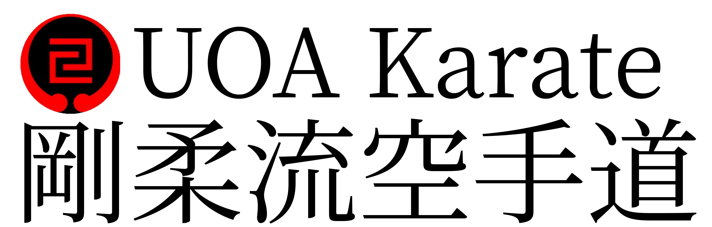

Wiki for the Auckland University Gōjū Ryū Karate Club, written in Vue.

Currently hosted at https://uoa-karate-wiki.netlify.app/ while under development. The original wiki can be found here at https://wiki.uoa-karate.club.

## Running the site

### Install dependencies

`yarn install`

### Run local version for development

`yarn serve`

### Build site for deployment

`yarn build`

### Check for broken links

`npm run check-links`

Builds the wiki and checks hyperlinks in the generated HTML, including navigation,
relative and directory URLs, linked files, and section anchors. A missing build or
broken internal link exits with status 1.

To also check external hyperlinks and embedded YouTube videos:

`npm run check-links -- --external --json=link-report.json`

External checks follow redirects, retry transient errors once, and check YouTube
metadata rather than assuming an HTTP 200 embed page means the video is playable.
The report lists source pages for each external URL. Exit status 1 means a broken
link was found; status 2 means a server error, timeout, or access restriction
prevented a complete external check. These are not reported as successful checks.
External section fragments and actual video playback are not validated.

To check an existing build without rebuilding:

`node scripts/check-links.mjs --dir=docs/.vuepress/dist`

Run the checker regression tests with `npm run test:links`.
